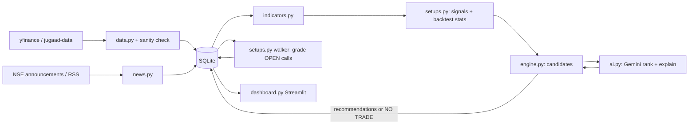

# feat: Indian Stock Research and Recommendation App

## Summary

One small Python package with two entry points: a scheduler process that fetches free delayed NSE data and news, runs coded setups, asks Gemini to rank and explain, and grades old calls; and a Streamlit dashboard that reads the same SQLite file. Indicators and backtests are plain pandas. No ORM, no web framework, no microservices.

---

## Problem Frame

See origin. The user wants an honest, measured personal research desk for Indian equities that explains every call, says NO TRADE when nothing is good, and tracks its own hit rate. v1 uses free delayed data and Gemini free tier to keep cost near zero.

---

## Requirements

Carries R1–R20 from origin unchanged.

**Origin actors:** A1 User, A2 Research engine, A3 Gemini
**Origin flows:** F1 Daily research run, F2 Grading, F3 Dashboard review
**Origin acceptance examples:** AE1 (R2), AE2 (R11, R12), AE3 (R8), AE4 (R14), AE5 (R16)

---

## Scope Boundaries

### Deferred for later
- Real-time broker data, scalping, live intraday monitoring.
- Telegram/email alerts, mobile layout.
- Options/futures.
- Parsing result PDFs and concall transcripts.

### Outside this product's identity
- Trade execution.
- Multi-user, auth, SaaS.
- ML training beyond hit-rate feedback.
- Portfolio accounting.

---

## Context & Research

Repo is empty (greenfield). No local patterns or learnings.

### External References (checked 2026-10-30)
- yfinance 1.7.0 is current. It is unofficial and for personal use. Expect throttling and occasional bad NSE values. https://pypi.org/project/yfinance/
- jugaad-data supports the current NSE site, including bhavcopy and corporate announcements. https://pypi.org/project/jugaad-data
- Gemini free tier includes 2.5 Flash-Lite, the cheapest capable model. The SDK is `google-genai`, and structured output is supported. Free-tier data may be used by Google for training. https://ai.google.dev/gemini-api/docs/pricing
- Economic Times RSS for markets and stocks. Google News RSS search per symbol.
- vectorbt 1.2.0 is maintained. Plain pandas is simpler for daily-bar signal and forward-return scans.
- pandas-ta is stale (beta, one maintainer). pandas-ta-classic is the active fork.

---

## Key Technical Decisions

- **Price data: yfinance primary, jugaad-data fallback.** yfinance is simplest. The fallback covers outages and bad values. One fetch module isolates both.
- **Sanity check on every price row.** Reject rows with zero, negative or more than 20% gap without a matching index move, and mark the symbol unavailable (AE1).
- **Indicators in plain pandas.** RSI, MACD, EMA, VWAP and pivots are short formulas. This avoids a stale dependency.
- **Backtest in plain pandas.** For each setup, find signal days over 3 years and walk forward bars to see target, SL or expiry first. The same function grades live calls (R7, R14). One code path for backtest and grading keeps the stats honest.
- **Gemini 2.5 Flash-Lite, one batched call per horizon per run.** Structured JSON output, schema-validated. Model name lives in `.env`. Upgrade to a Flash model only if quality is poor.
- **Gemini never sees free text it can price from.** Entry, SL and target come from setup rules. Gemini only ranks, writes reasoning, picks invalidation conditions and adjusts confidence within ±15 points (R8, R11).
- **SQLite via stdlib sqlite3.** Single file, single user, no ORM.
- **Two processes.** `python -m stockkk.worker` runs APScheduler jobs; `streamlit run stockkk/dashboard.py` reads the DB. Both start from one README command block.
- **Intraday = next-day plan.** Built post-close and refreshed pre-market from GIFT Nifty and global cues. Labelled as a plan, not a live signal.

---

## Open Questions

### Resolved During Planning
- vectorbt vs backtesting.py: neither. Plain pandas is enough for daily bars.
- Announcement source: jugaad-data first, with ET and Google News RSS as backup.
- Confidence formula: backtested hit rate blended with live hit rate once at least 20 live calls exist, plus Gemini's ±15 adjustment, clamped 0–100. Publish only if confidence ≥ 60 and RR ≥ 2 for intraday and swing, or RR ≥ 1.5 for long-term.

### Deferred to Implementation
- Exact Gemini rate limits for this project. Read them from AI Studio and tune batch sizes.
- Whether yfinance fundamentals for `.NS` are complete enough. If not, show "unavailable" for missing fields.
- Final setup thresholds. Tune after the first backtest run.

---

## Output Structure

    stockkk/
      config.py          # .env, thresholds, universe file path
      db.py              # sqlite schema + helpers
      data.py            # prices, fundamentals, global cues, sanity checks
      news.py            # announcements + RSS
      indicators.py      # RSI, MACD, EMA, VWAP, S/R, relative strength
      setups.py          # rule definitions + backtest/grade walker
      ai.py              # Gemini prompt, schema, validation
      engine.py          # daily run: candidates -> AI -> recommendations / NO TRADE
      worker.py          # APScheduler jobs
      dashboard.py       # Streamlit pages
    data/nifty500.csv
    tests/
    .env.example
    requirements.txt
    README.md

---

## High-Level Technical Design

> *This illustrates the intended approach and is directional guidance for review, not implementation specification.*

Worker schedule (IST):
- 16:30: full EOD scan, grading and recommendations.
- 08:30: pre-market refresh with global cues and the intraday plan.
- Hourly, 24/7: news scan.
- Sunday: re-run the backtest and refresh setup stats.

---

## Implementation Units

- U1. **Project skeleton, config, DB**

**Goal:** Installable package, `.env` config, SQLite schema.
**Requirements:** R13 (immutable recs), R2 (timestamps)
**Dependencies:** None
**Files:** `requirements.txt`, `.env.example`, `stockkk/config.py`, `stockkk/db.py`, `tests/test_db.py`
**Approach:** Tables for prices, fundamentals, news, setup_stats and recommendations. Recommendations get an append-only status column plus grade fields, and every row gets a `fetched_at`. A trigger blocks updates to the core fields of published recommendations.
**Test scenarios:**
- Happy path: insert a recommendation and read it back.
- Error path: updating the entry or target of a published recommendation raises an error (R13).
- Edge: a status update from OPEN to TARGET_HIT is allowed.
**Verification:** Fresh DB is created on first run.

- U2. **Market data fetch + sanity checks**

**Goal:** EOD OHLCV for Nifty 500, indices, global cues and fundamentals, with fallback and validation.
**Requirements:** R1, R2, R4 (fundamentals)
**Dependencies:** U1
**Files:** `stockkk/data.py`, `data/nifty500.csv`, `tests/test_data.py`
**Approach:** Batch yfinance downloads with retry and backoff. On failure or bad rows, try jugaad-data. Mark failed symbols unavailable with a reason. Store `fetched_at` and `source` per row.
**Test scenarios:**
- Covers AE1. Fetch returns empty: the symbol is marked unavailable and excluded downstream.
- Edge: a row with a 30% gap and a flat index is rejected.
- Error: yfinance raises, jugaad-data succeeds, and the source is recorded as the fallback.
- Happy path: a recorded fixture of RELIANCE.NS stores 750+ rows.
**Verification:** Manual smoke test on RELIANCE.NS and TCS.BO prints the latest close and timestamp.

- U3. **Indicators**

**Goal:** RSI, MACD, EMA 20/50/200, volume averages, pivots, support/resistance, 52-week high/low and sector relative strength.
**Requirements:** R3
**Dependencies:** U2
**Files:** `stockkk/indicators.py`, `tests/test_indicators.py`
**Approach:** Pure functions that take a DataFrame and return columns. VWAP is computed only when intraday bars exist; daily runs label it N/A.
**Test scenarios:**
- Happy path: RSI on a known series matches reference values to two decimals.
- Edge: a series shorter than 200 bars gives NaN EMA200, not an error.
- Happy path: MACD crossover is detected on a constructed series.
**Verification:** Indicators for 500 symbols compute in under 30 seconds.

- U4. **Setups + backtest/grade walker**

**Goal:** 4–5 coded setups per horizon, a 3-year backtest and stored stats. The same walker grades live calls.
**Requirements:** R6, R7, R14, R16
**Dependencies:** U3
**Files:** `stockkk/setups.py`, `tests/test_setups.py`
**Approach:** Each setup is a small dict or function giving signal, entry, SL, target and max hold. Starting setups:
- Volume breakout above 20-day high (swing).
- EMA20 pullback in an uptrend (swing).
- RSI-oversold reversal at support (swing).
- Gap-and-range plan for the next day (intraday).
- 52-week-high momentum plus quality fundamentals (long-term).

The walker steps bars forward and returns TARGET_HIT, SL_HIT or EXPIRED. When the target and SL fall inside the same bar, it assumes SL_HIT, the conservative choice. Stats stored per setup are hit rate, average RR, maximum drawdown and sample size. A setup is auto-disabled if its live hit rate falls under its threshold after at least 30 live calls.
**Test scenarios:**
- Covers AE4. Target 110 and SL 95: high hits 110 on day 3 before any low reaches 95, so TARGET_HIT on day 3.
- Edge: target and SL in the same bar give SL_HIT.
- Edge: neither is hit within max hold, giving EXPIRED at the last close.
- Covers AE5. 30 live calls below threshold disable the setup.
- Happy path: the backtest over a fixture produces stats with sample size above 0.
**Verification:** Backtest report prints per-setup stats. Setups with a backtested hit rate that gives negative expectancy start disabled.

- U5. **News + announcements**

**Goal:** Headlines and filings per symbol, stored with timestamps.
**Requirements:** R4, R5
**Dependencies:** U1
**Files:** `stockkk/news.py`, `tests/test_news.py`
**Approach:** Use jugaad-data corporate announcements, then ET RSS, then Google News RSS per candidate symbol. Dedupe on URL. Never summarise in this module; Gemini does that in U6.
**Test scenarios:**
- Happy path: an RSS fixture parses into rows with symbol, title, URL and published_at.
- Edge: a duplicate URL is stored once.
- Error: an NSE call failing falls back to RSS without crashing the job.
**Verification:** The hourly job adds new rows without duplicates.

- U6. **Gemini layer**

**Goal:** Rank candidates, write reasoning, adjust confidence and give invalidation conditions, or decline.
**Requirements:** R8, R10, R11
**Dependencies:** U4, U5
**Files:** `stockkk/ai.py`, `tests/test_ai.py`
**Approach:** One prompt per horizon. Input is a JSON list of candidates, each with its setup, levels, stats, indicators, fundamentals, recent news and a data timestamp. The response schema returns a list of `{symbol, rank, confidence_adj, reasoning, technical, fundamental, news, invalidation}` or an empty list. The prompt says to use only the provided numbers. The reply is validated, and items with an unknown symbol or confidence_adj outside ±15 are dropped and logged. On API failure, no recommendations are published for that horizon and the dashboard shows "AI unavailable" instead of fake reasoning.
**Test scenarios:**
- Covers AE3. A reply naming a symbol not in the candidates drops that item and logs a warning.
- Edge: confidence_adj of 40 drops the item.
- Error: a Gemini timeout gives "AI unavailable" and no published recs.
- Happy path: a recorded valid reply parses into recommendation objects.
**Verification:** A live call with 10 candidates returns valid JSON within free-tier limits.

- U7. **Engine: daily run + NO TRADE**

**Goal:** Tie U2–U6 together for each horizon and publish recommendations or NO TRADE.
**Requirements:** R9, R10, R11, R12, F1
**Dependencies:** U2–U6
**Files:** `stockkk/engine.py`, `tests/test_engine.py`
**Approach:** For each horizon:
- Collect signals from enabled setups.
- Keep the top 15 by backtest score and attach context.
- Call Gemini, then compute the final confidence.
- Filter by thresholds and publish at most 5. If none pass, publish NO TRADE with a reason.

Scalping always returns "unavailable: needs real-time data".
**Test scenarios:**
- Covers AE2. No candidate meets the threshold, so a NO TRADE row is published with its reason.
- Happy path: 3 candidates pass and 3 recs are stored with every R10 field populated.
- Edge: a candidate with RR 1.8 on swing is excluded.
- Integration: a full run with mocked data and Gemini writes recommendations, and grading then picks them up.
**Verification:** Running the engine once on real data produces recommendations or NO TRADE for each horizon.

- U8. **Worker schedule**

**Goal:** Run research 24/7.
**Requirements:** R5, F2
**Dependencies:** U7
**Files:** `stockkk/worker.py`
**Approach:** An APScheduler BlockingScheduler with IST cron jobs as in the design section. It also runs a catch-up job on start if the last EOD run is stale. Each job is wrapped so one failure logs and the scheduler continues.
**Test expectation:** none -- thin wiring; covered by the U7 integration test and a manual run.
**Verification:** The worker runs overnight and the logs show the hourly news jobs plus one EOD run.

- U9. **Streamlit dashboard**

**Goal:** Seven pages, a detail view and a disclaimer.
**Requirements:** R15, R17–R20, F3
**Dependencies:** U7
**Files:** `stockkk/dashboard.py`
**Approach:** One file using `st.navigation`. Pages:
- Today's Best.
- Intraday Plan.
- Swing.
- Long-term.
- Scalping, showing an unavailable notice.
- Market Overview: indices, global cues, sector heatmap.
- News.
- Performance: win rate, average RR, paper P&L curve, per-setup table with disabled flags.

Every value shows a "delayed · fetched HH:MM" badge. The disclaimer sits in the sidebar on every page. Streamlit caching is set to 60 seconds.
**Test expectation:** none -- UI; verified manually against the DB with seeded data.
**Verification:** All pages render with seeded data and with an empty DB, with no crashes.

---

## System-Wide Impact

- **Error propagation:** Data, news and AI failures degrade to "unavailable" labels, never to invented values.
- **State lifecycle:** Recommendations are append-only, and only their status and grade fields change.
- **Unchanged invariants:** Nothing places trades.

---

## Risks & Dependencies

| Risk | Mitigation |
|------|------------|
| yfinance breaks or returns bad NSE values | jugaad-data fallback, sanity checks, "unavailable" labels |
| NSE blocks the announcement scraping | RSS fallback |
| Gemini free-tier limits or model changes | One batched call per horizon, model name in `.env`, "AI unavailable" path |
| Free-tier prompts may be used for training by Google | Only public market data is sent. Noted in the README. |
| Backtest overfits | Simple rules, 3-year window, live hit rate overrides after 20 calls, auto-disable |
| Users read recommendations as advice | Disclaimer on every page. Personal use only. |

---

## Documentation / Operational Notes

- The README covers setup, the Gemini key, the two run commands and the data disclaimer.
- Runs on a Mac or a small VPS. NSE may block cloud IPs, so prefer home or Mac first.

---

## Sources & References

- **Origin document:** [docs/brainstorms/2026-10-30-indian-stock-research-app-requirements.md](../brainstorms/2026-10-30-indian-stock-research-app-requirements.md)
- yfinance: https://pypi.org/project/yfinance/
- jugaad-data: https://pypi.org/project/jugaad-data
- Gemini pricing: https://ai.google.dev/gemini-api/docs/pricing
- Gemini structured output: https://ai.google.dev/gemini-api/docs/structured-output
